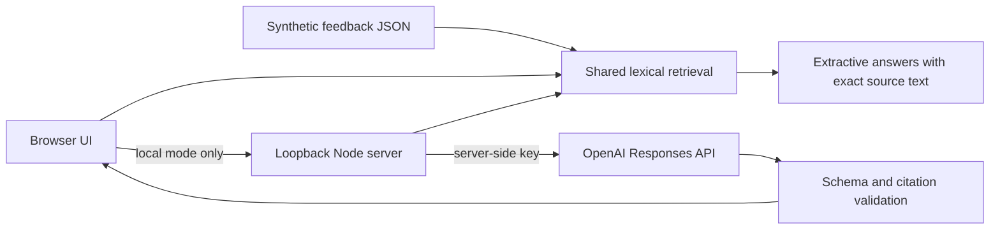

# Architecture and decisions

## Static deployment first

GitHub Pages hosts only `docs/`. Browser queries run locally against the bundled synthetic data. There are no analytics, credentials, remote model calls or uploads in static mode. This makes the demonstration reproducible and avoids presenting a simulated model response as live AI.

## One retrieval implementation

`docs/engine.mjs` is imported by the browser, local server, tests and evaluation runner. It tokenizes text, applies simple plural normalization, weights overlap by inverse document frequency, requires at least two matching content tokens when available, and returns up to five records above a minimum score. Scores are ranking heuristics, not probabilities or confidence estimates.

The minimum overlap trades recall for fewer unrelated matches. It misses synonym pairs such as “duplicate charges” and “charged twice.” The diagnostic report intentionally records those misses. Semantic retrieval is a next milestone, not an implemented feature.

## Model boundary

Only the loopback server can call the provider. The model and key are environment configuration. Model input contains only synthetic retrieved records and a bounded question. Feedback text is never interpolated into trusted instructions. Requests use structured outputs, `store: false`, bounded output and a timeout.

The validator checks answer shape, nonempty evidence, retrieved source IDs and literal quote membership. These checks prevent invented source references, but do not establish entailment or defend against every prompt injection. The injection unit test verifies message construction only; a live adversarial evaluation is still required.

## Local service constraints

The local server has an explicit static-file allowlist, local Host and Origin validation, request-size and question-length limits, an in-memory request counter and generic provider error responses. It has no persistent user store. This is not a production authorization or abuse-prevention system. Do not expose it directly to the Internet.

## Evaluation

The suite contains answerable and unanswerable questions. It computes per-query recall at five, reciprocal rank and abstention decisions; the summary includes failure cases. It does not measure semantic answer correctness or live model performance. The questions are development fixtures rather than unseen test data.
