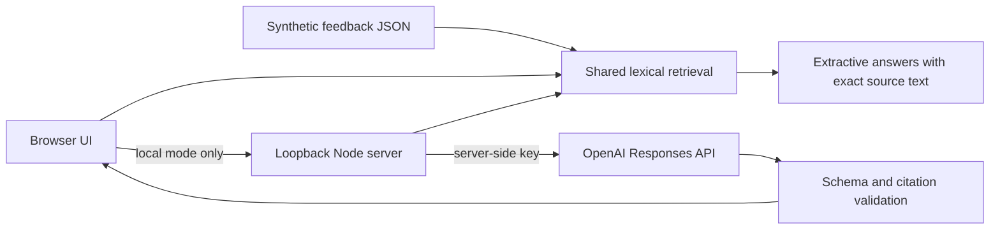

# Architecture and decisions

## Static deployment first

GitHub Pages hosts only `docs/`. Browser queries run locally against the bundled synthetic data. There are no analytics, credentials, remote model calls or uploads in static mode. This makes the demonstration reproducible and avoids presenting a simulated model response as live AI.

## One retrieval implementation

`docs/engine.mjs` is imported by the browser, local server, tests and evaluation runner. It removes question-framing stop words, strips common word endings, weights each query term by inverse document frequency within the selected channel, and cites up to five records that contain at least two query terms. Only when no record qualifies does it accept a single rare term carrying at least 40% of the question's weight, and the UI labels that a weaker match. Scores are ranking heuristics, not probabilities or confidence estimates.

Every result carries an explanation (searched terms, terms absent from the scope, the rule applied, and related records that were not cited) so the UI can say why it answered or abstained. Version 3 adds a small hand-written glossary (for example bill ~ charge, team member ~ teammate, slow ~ timeout); synonyms outside it are still missed. The original v1 retriever is frozen in `evaluations/lexical-v1.mjs`; `npm run evaluate` scores both on the development and challenge sets (see `evaluations/RETRIEVAL-V2.md`). Semantic retrieval is a next milestone, not an implemented feature.

## Question router

`docs/assistant.mjs` sits on top of the engine and is shared by the browser and the local server. It handles each question in this order:

1. Decline requests for credentials or financial data.
2. Answer help and greeting questions.
3. Search first when the question names something specific.
4. Otherwise answer from metadata: overview, urgency, requests, praise, recency, counts, channel comparison or a theme listing.
5. Failing that, return an explicit non-answer with related context and suggested questions.

Listings use authored labels and explicit keyword rules, exclude the injection-test fixture and quote records verbatim, so they pass the same citation validator. Facet listings are skipped when the question names something no record mentions. This keeps the product useful without a model while remaining inspectable. It is not natural-language understanding, and English keyword patterns will misroute some questions. In live mode the router selects the records and the model only writes claims about them.

## Scope versus library filters

The channel is the only filter that changes what the engine searches, so it is presented as the answer scope and re-runs the current question when changed. Theme chips, text search and “Cited only” filter the library view only. Following a citation clears any library filter that would hide the cited record and announces that it did so.

## Model boundary

Only the loopback server can call the provider. The model and key are environment configuration. Model input contains only synthetic retrieved records and a bounded question. Feedback text is never interpolated into trusted instructions. Requests use structured outputs, `store: false`, bounded output and a timeout.

The validator checks answer shape, nonempty evidence, retrieved source IDs and literal quote membership. These checks prevent invented source references, but do not establish entailment or defend against every prompt injection. The injection unit test verifies message construction only; a live adversarial evaluation is still required.

## Local service constraints

The local server serves only files inside `docs/` with an allowlisted extension (HTML, CSS, JavaScript modules, JSON), rejecting encoded traversal, local Host and Origin validation, request-size and question-length limits, an in-memory request counter and generic provider error responses. It has no persistent user store. This is not a production authorization or abuse-prevention system. Do not expose it directly to the Internet.

## Evaluation

The suite contains answerable and unanswerable questions. It computes per-query recall at five, reciprocal rank and abstention decisions; the summary includes failure cases. It does not measure semantic answer correctness or live model performance. The questions are development fixtures rather than unseen test data.

## Offline comparison boundary

The provider-neutral comparison CLI imports already collected outputs and never invokes an API. It requires matching dataset/prompt hashes and trial counts, rejects duplicate records, and counts missing attempts against the full planned denominator. Structural citation and reference-label checks remain separate from semantic correctness, which is unreviewed. Cost and token totals stay unknown when any expected attempt has incomplete usage. Fixture responses and timing are scripted. See experiments/comparison/README.md for the import contract and limitations.

## Local request observability

The server records one event per local answer response: finish, or close when finish has not occurred. Timing starts after local Host/Origin validation and spans body reading, validation, answer computation and response finishing/aborting. Only fixed route/method and allowlisted mode/outcome values enter a bounded, process-local ring. GET status/static/export traffic and rejected Host/Origin requests are excluded. Export uses the same loopback/origin guards and no-store policy. Quantiles are retained-sample statistics, not lifetime metrics or a production SLO. A disconnected client is not silently counted as a completed success. Tests exercise real HTTP completion/disconnection and ensure arbitrary strings/body fields cannot enter exported records. No content or provider usage is persisted.
